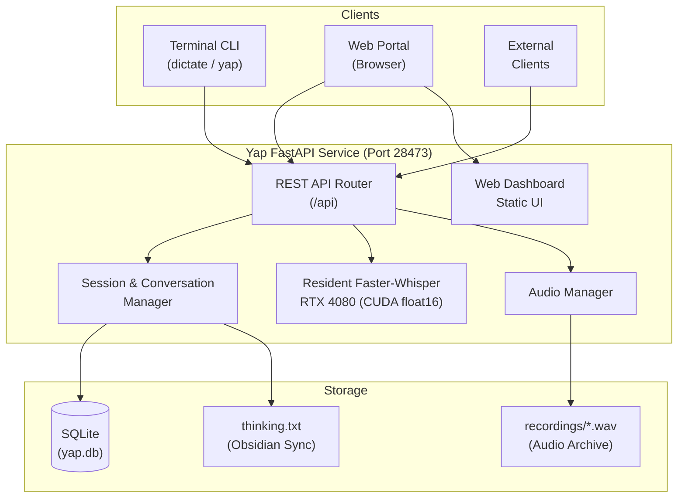

# Yap Multi-Client Platform & Web Portal Plan

## 1. Vision & Architecture

Transform **Yap** from a single-machine local CLI into an extensible **Multi-Client Voice Dictation & Conversation Platform**, while preserving the ultra-fast local terminal workflow.



---

## 2. Data Model (`yap.db`)

SQLite database stored locally at `/mnt/NewVolume/projects/yap/yap.db`.

### `sessions` Table
- `id` (TEXT, Primary Key): e.g. `ses_20261031_174000` or UUID.
- `title` (TEXT): Auto-generated from turn 1 or user-edited.
- `created_at` (DATETIME): Creation timestamp.
- `updated_at` (DATETIME): Last activity timestamp.
- `client_type` (TEXT): Client origin (`"cli"`, `"web"`, `"api"`).
- `is_active` (INTEGER): Default active session for CLI quick-capture.

### `turns` Table
- `id` (INTEGER, Primary Key AUTOINCREMENT).
- `session_id` (TEXT, Foreign Key -> `sessions.id`).
- `turn_index` (INTEGER): 1, 2, 3... within the session.
- `timestamp` (DATETIME): Capture timestamp.
- `transcript` (TEXT): Transcribed speech.
- `audio_filename` (TEXT): Relative path in `recordings/`.
- `audio_duration` (REAL): Audio duration in seconds.
- `infer_duration` (REAL): GPU inference time in seconds (~0.08s).

---

## 3. API Endpoints Specification

FastAPI daemon listening on `http://127.0.0.1:28473`:

### A. Session Management
- `POST /api/sessions`: Create a new session.
- `GET /api/sessions`: List sessions (sorted by recency, with turn counts and preview).
- `GET /api/sessions/active`: Get or auto-create the active session.
- `GET /api/sessions/{session_id}`: Retrieve session metadata and all turns.
- `PATCH /api/sessions/{session_id}`: Rename title or set active.
- `DELETE /api/sessions/{session_id}`: Delete session & associated turns.
- `GET /api/sessions/{session_id}/raw`: Return full concatenated conversation text formatted for 1-click clipboard copy.

### B. Audio & Transcription
- `POST /api/sessions/{session_id}/transcribe`:
  - Accepts `multipart/form-data` (audio file from browser or remote client).
  - OR accepts JSON `{"wav_path": "/path/to/local.wav"}` (zero-copy for local CLI speed).
  - Transcribes via resident Faster-Whisper on RTX 4080.
  - Inserts turn into SQLite, saves audio in `recordings/`, updates `thinking.txt`.
- `GET /api/recordings/{filename}`:
  - Streams WAV audio with `Range` header support for seeking and browser playback.

### C. System & Backward Compatibility
- `GET /health` and `GET /api/health`: Health status, model status, and device info.
- `POST /transcribe`: Legacy endpoint preserved for backwards compatibility.

---

## 4. Web Portal Dashboard UI

Served directly by FastAPI at `http://127.0.0.1:28473/`:

1. **Sidebar / Session Navigator**:
   - `+ New Session` button.
   - Search filter across sessions.
   - Recent sessions list with turn counts and previews.
2. **Conversation View**:
   - Editable session title.
   - Action buttons: "Copy Entire Conversation", "Export Markdown", "Delete".
   - Turn timeline:
     - Turn number and timestamp.
     - Audio player (scrubber, play/pause, speed).
     - Full transcript text.
     - Copy button per turn.
3. **In-Browser Dictation Bar (Bottom)**:
   - Microphone button for direct in-browser recording via Web Audio API.
   - Live visual audio meter and timer.
   - Instant transcription & append on stop.

---

## 5. Terminal CLI (`dictate.py`) Continuity

- `dictate` / `yap` / `Meta+Y` automatically attach to the active session.
- Optional CLI arguments:
  - `yap -n "Session Name"`: Start a new named session.
  - `yap -s <session_id>`: Attach to a specific session.
- Instant clipboard copy (`wl-copy` / `xclip`) and logging to `thinking.txt` remain intact.

---

## 6. Detailed Code Structure Plan

```text
/mnt/NewVolume/projects/yap/
├── db.py                      # SQLite database operations & session/turn management
├── whisper_server.py          # FastAPI daemon: GPU Faster-Whisper + REST API + Static UI
├── dictate.py                 # Interactive terminal CLI (synced with active session)
├── whisper-dictate.service    # Systemd user service unit
├── thinking.txt               # Plain text chronological stream-of-consciousness log
├── PLAN.md                    # Architecture and code structure specification
├── README.md                  # Project documentation
│
├── web/                       # Web Portal Dashboard (served at http://127.0.0.1:28473/)
│   ├── index.html             # Single-page dashboard UI
│   ├── css/
│   │   └── style.css          # Clean dark theme, responsive layout, audio player styles
│   └── js/
│       ├── api.js             # REST API client wrapper
│       ├── recorder.js        # In-browser microphone capture (MediaRecorder + AudioContext)
│       └── app.js             # UI state, session switching, turn rendering & 1-click copy
│
├── recordings/                # Lossless 16 kHz Mono WAV audio storage
│   ├── YYYY-MM-DD_HH-MM-SS.wav
│   └── README.md
│
└── yap.db                     # SQLite database (auto-created on startup)
```

### Module Responsibilities:

- **`db.py`**:
  - Encapsulates SQLite connection with WAL (Write-Ahead Logging) for concurrent access.
  - CRUD operations for sessions (create, list, get, update, delete, get active).
  - CRUD operations for turns (append turn, renumber, delete).
  - Raw conversation text formatter for 1-click copy.
- **`whisper_server.py`**:
  - Initializes Faster-Whisper on RTX 4080 (CUDA float16) with thread-safe inference lock.
  - Mounts FastAPI routes: `/api/sessions`, `/api/recordings`, `/api/transcribe`, `/api/health`.
  - Supports dual audio ingestion: raw WAV path (zero-copy for local CLI) and multipart file upload (for browser/web clients).
  - Serves the static `web/` portal files at `/`.
- **`web/`**:
  - Self-contained web app (no `node_modules` or build pipeline needed).
  - Provides session navigation, search, inline audio playback, raw conversation copy, and mic recording.
- **`dictate.py`**:
  - Upgraded CLI that retrieves the active session from the server and posts transcribed audio to register turns, while maintaining the rapid `[ENTER]` $\to$ speak $\to$ `[ENTER]` clipboard copy flow.


---

## 7. Implementation Roadmap

1. **Step 1: Install Dependencies**
   - Install `fastapi`, `uvicorn`, `python-multipart` into `/home/iro/.local/share/dictate-venv/`.
2. **Step 2: Database Layer (`db.py`)**
   - Implement SQLite tables, connection handling, session CRUD, and turn persistence.
3. **Step 3: Upgrade Daemon (`whisper_server.py`)**
   - Migrate to FastAPI with GPU Faster-Whisper resident in VRAM.
   - Implement REST endpoints and static file serving.
4. **Step 4: Build Web Dashboard (`web/`)**
   - Build responsive web interface (session manager, audio players, copy tools, in-browser dictation).
5. **Step 5: Enhance CLI Client (`dictate.py`)**
   - Connect terminal recordings to active sessions via the API.
6. **Step 6: Service Restart & Verification**
   - Restart `whisper-dictate.service` and verify CLI, API, and web UI.
